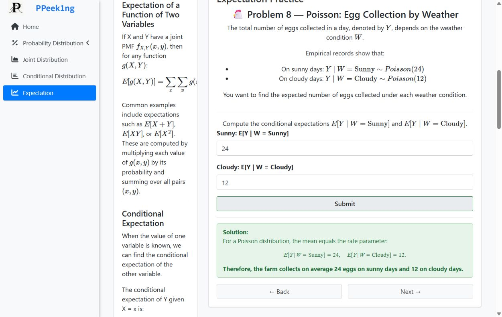

# Full verification and fixes on 2026-10-30

Baseline `e99d6e7`, after the first three local fixes. This round fixed the remaining eight first-round issues, reran the previous three and addressed R2-01–R2-07. **All 11 first-round issues and seven additional groups were fixed and verified, awaiting teacher review.** The round was unpushed and undeployed at that stage.

## Main results

| Area | Resulting behaviour |
|---|---|
| Thirteen Conditional questions | Q4 approximately .3472, Q10 approximately .0478. Full-precision checking with rounded display. Complete controlled name aliases reject wrong models and negations. |
| Geometric convention | Failures Z=Y−1 start at 0. Attempts Y start at 1. Q6 retains P(Y≥3)=.64. |
| Nine Expectation questions | Q4 accepts exact fractions and permitted two-place decimals. Q8 checks both labelled fields and identifies the wrong condition. Zero marginals are undefined. |
| Joint/Conditional/Expectation tables | Session-local state with within-session synchronisation. Invalid input retains valid results. Tiny positive values avoid zero fractions or denominators. |
| Overview | Geometric/NegBin p=1 retained, invalid Uniform a=b reported with recovery, infinite-density endpoints omitted from sampled plots with explanations, density distinguished from point probability. |
| Seven game chapters | Explicit model assumptions. Hypergeometric uses a fixed sample of four with N=7/M=1. Binomial uses ten independent warehouses, p=.5 and an unknown success total. Restart resets state without registering the module again. |
| Launcher/interface | Standard app.R serves www images. Wrapping table/controls and card-local scrolling prevent overlap. Dark headers are readable and navigation retains the theme. |

Details are in [ISSUES.md](../ISSUES.md). `app.R` is a standard entry point using the existing `main.R`. The original archive was unchanged at that stage.

## Automated verification

| Test | Passed / total | Evidence |
|---|---|---|
| Joint exercise module | 102/102 | [final_r1_04_ui.json](final_r1_04_ui.json) |
| Independent rational table/event/hint/solution calculations | 10/10 | [final_r1_04_math.json](final_r1_04_math.json) |
| Conditional table, 3D and bird's-eye outputs | 11/11 | [final_r1_05.json](final_r1_05.json) |
| Three-module input and within-session synchronisation | 124/124 | [final_r1_06.json](final_r1_06.json) |
| Remaining issues, boundaries, exercises/game and two sessions | 300/300 | [final_remaining.json](final_remaining.json) |
| Image HTTP / MIME resources | 13/13 | [final_assets.json](final_assets.json) |

Module/interaction checks totalled **537/537**, with rational calculations and assets recorded separately. Earlier R1-04/05/06 assertions were retained with explicit session-state initialisation. Historical evidence was preserved.

The 300 checks covered all 13 Conditional questions and three feedback levels, seven distribution-name questions with case/suffix/wrong-name/negation inputs, all nine Expectation questions including Q8 pairs, exact/approximate inputs, zero/tiny marginals, representative parameters for seven discrete and eight continuous models, plot selection, 15 discrete/Uniform boundaries, eight continuous plots and four singular endpoints. They also covered all seven game chapters, hints, scoring, three restart rounds and two simultaneously live app-server mock sessions with independent submitted data.

The environment was Windows, R 4.6.1 and Shiny 1.14.0, using existing project packages and Python's standard library. Reports contain source MD5 and launcher/resource SHA-256 values. Tests explicitly used UTF-8 and exited with code 0 despite existing startup locale messages.

```powershell
./review/scripts/run_regression.ps1
```

Start the app before checking resources in a second terminal.

```powershell
Rscript Start-Shiny.R --no-browser
# In another terminal
./review/scripts/test_assets.ps1
```

## Browser verification

Actual actions and results are in [final_browser.json](final_browser.json). Screenshots show the local app.

- Conditional rejected Negative Binomial for a Binomial question. Q4 accepted .347229417554172 and showed approximately .3472, 34.72%.
- Expectation accepted `10000/3`. Sunny=24, Cloudy=13 identified Cloudy as wrong. Changing it to 12 passed both fields.
- Tab A submitted `.1,.2,.3,.4`. Tab B retained its default fractions, then generated a uniform table while A retained its own values.
- All seven game chapters completed with 21 points. Restart returned to the start. Wrong-answer branches and repeated restarts were covered by module tests.
- Layouts at 1266×800 and 900×800 showed separate table/control regions and internal scrolling for long formulas.
- The logo and opening image loaded visibly, with all 13 assets covered by HTTP checks.
- Dark headers used readable light text on a dark background. The theme survived navigation and returned to light mode correctly.



## Remaining review scope

The checks cover the confirmed issues and specified inputs. All slider/device/browser/keyboard/screen-reader combinations and production multi-user load testing remained outside this run. Continuous densities use finite samples, and sharp peaks can be difficult to distinguish on linear axes. Teachers still need to review course suitability and scenario choices. The downloaded STATS210 source was the 2024 edition. Automated runtime was recorded separately from human effort.
