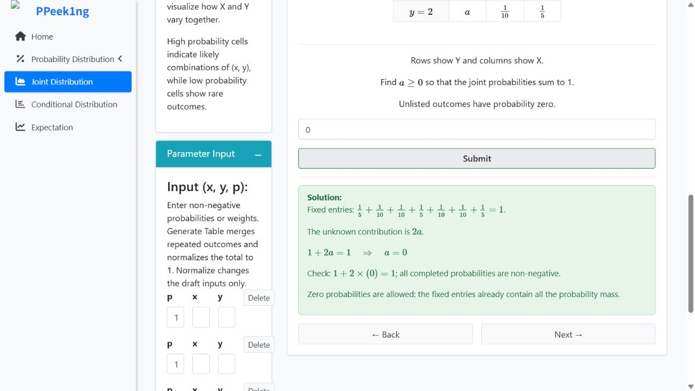

# R1-04 联合分布题库修复验证

日期：2026-10-30（Pacific/Auckland）。修复前基线：`d76627f`。状态：**已修复、已验证，待教师复核**。独立本地提交说明：`Fix R1-04 joint probability question bank consistency`；未推送或部署。

## 题库修复

保留原有 10 题及学习目标。Joint 的 `get_joint_question_bank()` 统一定义整数权重、分母、事件条件或未知参数系数，从同一份数据生成表格、答案、提示和解答。分数先约分，判题使用精确计算值。完整表或代入正确参数后的表必须非负且总和为 1。

| 题号 | 表格修改（坐标为 x,y） | 当前目标与正确答案 |
|---|---|---|
| Q1 | f(2,0)：1/24→1/3 | P(X=1,Y=1)=1/8 |
| Q2 | f(0,0)：1/10→3/10 | P(X=2,Y=1)=1/20 |
| Q3 | f(0,0)：1/9→1/6 | f_X(1)=7/18 |
| Q4 | f(0,1)：1/24→11/24 | f_Y(0)=7/24 |
| Q5 | 保留原表 | P(X>0,Y≤1)=1/2 |
| Q6 | 保留原表 | P(X+Y≥3)=5/12 |
| Q7 | 保留 8 个已知格和 1 个缺失格 | 已知和 23/24，缺失概率 p=1/24 |
| Q8 | 保留原表，明确 a≥0 | 已知和 1，1+2a=1，因此 a=0 |
| Q9 | 保留原概率公式与列举形式 | 系数和 18，k=1/18 |
| Q10 | 保留原表及边际问号，明确只合计内部 9 格 | 已知和 2/3，p=1/9 |

Q1–Q4 修正非目标格，保留查表或边际求和的学习目的。Q8 的两个未知格可以为零，提示和解答解释这一点。Q7 解答明确把缺失概率定义为 p。Q10 区分边际问号和内部 p，避免重复计算边际。

Joint 判题增加有限且非负检查，避免在 a=0 时把微小负数当作容差内正确答案。其他模块的答案判断未改动，既有精度容差保持不变。

## 独立数学验证

[test_r1_04_math.py](../scripts/test_r1_04_math.py) 只使用 Python 标准库，读取实际题库生成的 HTML，不使用 R 生成器的权重数组：

- 解析表格方向、内部联合概率和未知参数系数，使用 Fraction 独立求和与求参数；Q10 排除边际格。
- 核对题干目标、精确分数及数值答案；Q1–Q6 核对提示/解答坐标与目标事件。
- 解析数值等式并用有理数逐步复算；参数等式代入独立求得的正确值。新解答必须有实际核验的数值等式，避免全部被跳过仍通过。
- 10 张完整/补全表均精确合计 1 且无负项。

基线 [修复前数学结果](r1_04_before_math.json) 为 **2/10**，修复后 [数学结果](r1_04_math.json) 为 **10/10**。基线 8 个失败题与首轮记录一致。填空表按独立求解的参数补全后，还另外核对存储答案，不能把补全表合法当作原答案正确。

## 实际模块交互验证

[test_r1_04.R](../scripts/test_r1_04.R) 使用真实 joint_Server 和 shiny::testServer：

- 逐题验证当前表和题干、第一次/第二次错误提示、第三次完整解答。
- 独立给定正确分数与五位小数，验证成功反馈；错误数值、空值及 abc 必须失败。
- 验证翻页重置提示/尝试次数、首尾页边界；Q8 的 -0.000001 必须失败。

基线 [修复前 UI 结果](r1_04_before_ui.json) 为 **92/102**，修复后 [UI 结果](r1_04_ui.json) 为 **102/102**。UI 通过率不能替代数学验证，基线中很多按钮流程本来就能运行。

## 回归与范围

- **R1-05：11/11 通过**，[本次重跑](r1_05_after_r1_04.json)。
- **R1-06：124/124 通过**，[本次重跑](r1_06_after_r1_04.json)。
- 原 R1-04 首轮证据、R1-05/R1-06 旧证据均保留。概率编辑器及共享 PMF 动作代码未改动；Conditional、Expectation 源码未修改。

从仓库根目录运行（Rscript 本机路径为 `C:\Program Files\R\R-4.6.1\bin\x64\Rscript.exe`）：

```powershell
Rscript --vanilla review/scripts/test_r1_04.R
python review/scripts/test_r1_04_math.py
Rscript --vanilla review/scripts/test_r1_05.R review/evidence/r1_05_after_r1_04.json
Rscript --vanilla review/scripts/test_r1_06.R review/evidence/r1_06_after_r1_04.json
```

## 浏览器核对

本地应用中依次实际翻页：Q5 提交 1/2 出现成功反馈，解答为 1/10+1/5+1/10+1/10=1/2；Q8 提交旧答案 0.1 得到警告，提交 0 得到成功反馈，解释 1+2a=1 和零概率合法。最后重新加载最终代码，核对 Q1 的修正表包含 f(2,0)=1/3。




全部 10 题的提示层级、答题格式和页边界由模块交互检查覆盖，没有宣称每种输入都在浏览器重复点击。微小负数由模块测试验证。教师复核、剩余 8 项问题与多会话隔离仍待后续处理。
