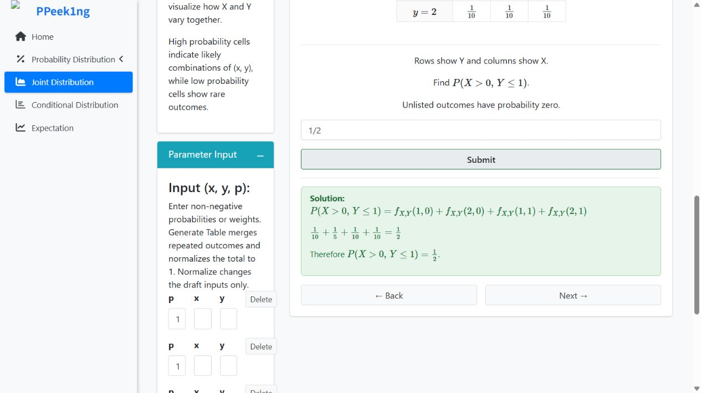

# R1-04 joint-distribution question-bank verification

Date 2026-10-30, Pacific/Auckland. Before-fix baseline `d76627f`. **Fixed and verified, awaiting teacher review.** Local commit title `Fix R1-04 joint probability question bank consistency`. Unpushed and undeployed at this stage.

## Question-bank changes

The original 10 questions and learning objectives were retained. `get_joint_question_bank()` defines integer weights, denominators, event conditions and unknown-parameter coefficients in one data source, generating tables, answers, hints and solutions consistently. Fractions are reduced and answer checking uses calculated values. Completed tables must be nonnegative and sum to 1.

| Question | Table change, coordinates (x,y) | Target and correct answer |
|---|---|---|
| Q1 | f(2,0) changed from 1/24 to 1/3 | P(X=1,Y=1)=1/8 |
| Q2 | f(0,0) changed from 1/10 to 3/10 | P(X=2,Y=1)=1/20 |
| Q3 | f(0,0) changed from 1/9 to 1/6 | f_X(1)=7/18 |
| Q4 | f(0,1) changed from 1/24 to 11/24 | f_Y(0)=7/24 |
| Q5 | Original table retained | P(X>0,Y≤1)=1/2 |
| Q6 | Original table retained | P(X+Y≥3)=5/12 |
| Q7 | Eight known cells and one missing cell retained | Known sum 23/24, missing p=1/24 |
| Q8 | Original table retained, with a≥0 stated | Known sum 1, so 1+2a=1 and a=0 |
| Q9 | Original probability formula and listing retained | Coefficients sum to 18, k=1/18 |
| Q10 | Original table and marginal question marks retained, with only nine interior cells summed | Known sum 2/3, p=1/9 |

Q1–Q4 change non-target cells while retaining the reading/marginal objectives. Q8 explains why the unknown cells may have zero probability. Q7 explicitly names the missing probability p. Q10 distinguishes marginal question marks from interior p values.

Joint answer checking additionally requires finite, nonnegative input, rejecting tiny negative values near a=0 before tolerance comparison. Existing tolerances and other modules' checkers were retained.

## Independent mathematical checks

[test_r1_04_math.py](../scripts/test_r1_04_math.py) uses Python's standard library and parses the generated HTML independently of the R generator's weight arrays.

- Parse table orientation, interior probabilities and unknown coefficients, then calculate with Fraction. Exclude Q10 marginal cells.
- Check question targets, exact fractions and numerical answers. Check Q1–Q6 hint/solution coordinates against the event.
- Recalculate numerical equations with rational arithmetic, substituting independently solved parameters. Require actual checked equations in new solutions.
- Check all 10 completed tables sum exactly to 1 and have no negative entries.

The [before-fix result](r1_04_before_math.json) was **2/10**, and the [fixed result](r1_04_math.json) **10/10**. The eight failures agree with the first audit. Missing-cell tables were completed with independently solved parameters and their stored answers checked separately.

## Actual module interactions

[test_r1_04.R](../scripts/test_r1_04.R) uses the real joint_Server and shiny::testServer. It checks each table/question, first and second hints, third-attempt solution, correct fractions and five-place decimals, wrong/empty/abc input, navigation resets and page boundaries. Q8 input -0.000001 must fail.

The [before-fix interaction result](r1_04_before_ui.json) was **92/102**, and the [fixed result](r1_04_ui.json) **102/102**. Many button workflows already worked in the baseline, so mathematical checks were recorded separately.

## Regression and scope

- R1-05 passed **11/11** in the [rerun](r1_05_after_r1_04.json).
- R1-06 passed **124/124** in the [rerun](r1_06_after_r1_04.json).
- Existing first-round and earlier fix evidence was retained. The probability editor, shared PMF actions and Conditional/Expectation source were outside this patch.

Run from the repository root. The local Rscript was `C:Program FilesRR-4.6.1indRscript.exe`.

```powershell
Rscript --vanilla review/scripts/test_r1_04.R
python review/scripts/test_r1_04_math.py
Rscript --vanilla review/scripts/test_r1_05.R review/evidence/r1_05_after_r1_04.json
Rscript --vanilla review/scripts/test_r1_06.R review/evidence/r1_06_after_r1_04.json
```

## Browser checks

Q5 accepted 1/2 and showed 1/10+1/5+1/10+1/10=1/2. Q8 rejected the old 0.1 and accepted 0, explaining 1+2a=1 and valid zero probabilities. Reloading the final code confirmed Q1's f(2,0)=1/3.




All hint levels, answer formats and boundaries were covered by module tests. Browser checks exercised the selected cases above. Tiny-negative rejection was checked at module level. Teacher review, eight remaining issues and multi-session isolation remained follow-up work at this stage.
