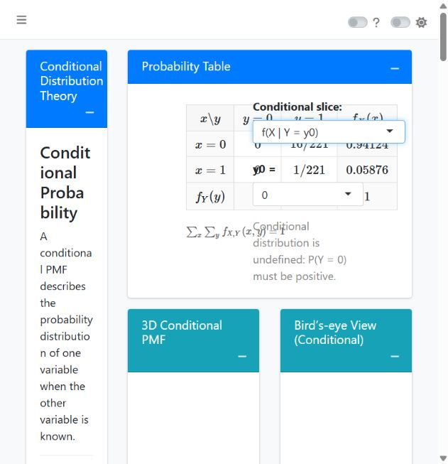

# R1-05 fix verification

Date 2026-10-30, Pacific/Auckland. Before-fix baseline `a5eabad`, whose app source matched audit baseline `0f609de`. **Fixed and verified, awaiting teacher review.**

## Change

`module_conditional.R` originally passed a scalar condition to `ifelse`, returning the first probability, which `mutate` repeated. Both conditioning directions now validate a positive finite marginal and divide the complete vector by it. Zero marginals produce “Conditional distribution is undefined”.

## Module-output regression

[test_r1_05.R](../scripts/test_r1_05.R) runs the real `conditional_Server` with `shiny::testServer`, reading `cond_table_html`, `plot3d_cond` and `plot_bird_cond`. The historical table assertions use five-place display values and totals, while plot assertions use unrounded values.

| Case | Expected display/behaviour | Fixed result |
|---|---|---|
| Default Y\|X=0 and X\|Y=0 | .92157, .07843, total 1.00000 | Both pass |
| Default Y\|X=1 and X\|Y=1 | .94124, .05876, total 1.00000 | Both pass |
| Nonuniform 2×3 table, X=0 and 1 | (1/3,1/6,1/2) and (2/7,3/7,2/7) | Both pass |
| Same table, Y=0, 1 and 2 | (1/3,2/3), (1/7,6/7), (3/7,4/7) | All three pass |
| Zero X or Y marginal | Undefined validation message, with no probability table | Both pass |

Before **0/11**, after **11/11**. Nine valid slices were compared with both plot outputs. Two zero-marginal cases checked the validation type and message. The default input parser then used five-place values. Individually rounded entries can differ from 1 by 0.00001, while the total uses unrounded probabilities.

- [Before](r1_05_before.json), the table showed `.92157,.92157`, total `1.84313`, while the plots were correct.
- [After, with source MD5](r1_05_regression.json), all 11 pass and the default table shows `.92157,.07843`, total `1.00000`.

Run from the repository root.

```powershell
& 'C:Program FilesRR-4.6.1inRscript.exe' --vanilla review/scripts/test_r1_05.R
```

The available R version was 4.6.1. The former 4.6.0 path was unavailable. Shiny and missing dependencies were installed from CRAN into ignored `.R-library/`. Existing locale startup warnings did not prevent the tests.

## Browser verification

`Start-Shiny.R --no-browser` served the app at `http://127.0.0.1:7125/`, using actual selectors and input fields.

1. Conditional's default `f(Y|X=0)` displayed `.92157,.07843`, total `1.00000`.
2. `f(X|Y=0)` gave the same pair. Switching to Y=1 gave `.94124,.05876`, total `1.00000`.
3. Setting (0,0) and (1,0) to zero, leaving the other cells positive, generating and choosing `f(X|Y=0)` showed `Conditional distribution is undefined: P(Y = 0) must be positive.`
4. The original four fractions were restored and generated.

The browser zero-marginal check used Y. The opposite direction and every nonuniform 2×3 slice were covered by module tests. The existing R1-10 layout issue remained outside this patch.




## Delivery scope at that stage

The patch covered conditional-table calculations and denominator feedback. Question banks, answer checking, PMF input validation and session isolation retained their baseline implementations. The local commit title was `Fix R1-05 conditional probability table normalization`, with SHA available in Git history. No course files were uploaded, and the patch was unpushed and undeployed at that stage.
