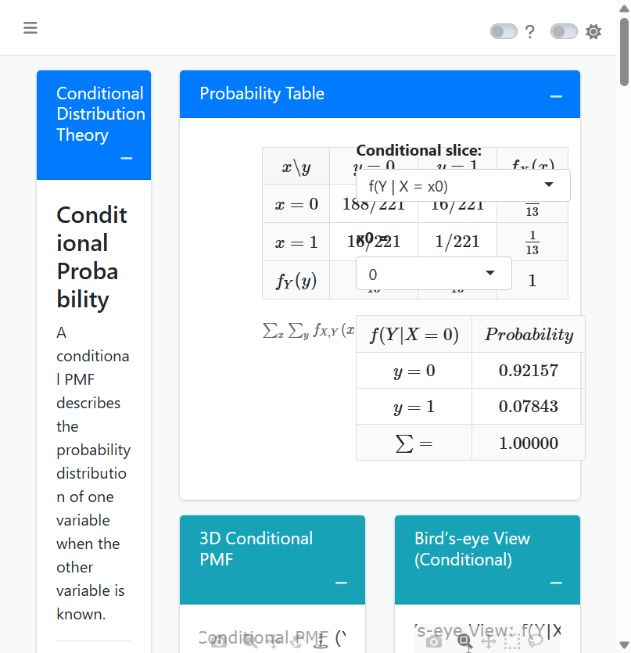

# R1-05 修复验证

日期：2026-10-30（Pacific/Auckland）。修复前基线：`a5eabad`；应用源码与原审查基线 `0f609de` 一致。状态：**已修复、已验证，待教师复核**。

## 修改

`module_conditional.R` 原先用标量条件调用 `ifelse`，只返回第一个概率，随后 `mutate` 将其重复。现在在两个方向先验证边际概率为正且有限，再对全部单元格直接做向量除法。零边际输出“Conditional distribution is undefined”提示，不再生成伪全零条件分布。

## 模块输出回归

脚本：[test_r1_05.R](../scripts/test_r1_05.R)。使用真实 `conditional_Server` 的 `shiny::testServer`，读取 `cond_table_html`、`plot3d_cond`、`plot_bird_cond` 输出，与独立预期值比较。表格验证五位小数显示与合计；两个图形按未舍入值比较。

| 案例 | 预期显示/行为 | 修复后 |
|---|---|---|
| 默认 Y\|X=0、X\|Y=0 | .92157、.07843；合计 1.00000 | 两例通过 |
| 默认 Y\|X=1、X\|Y=1 | .94124、.05876；合计 1.00000 | 两例通过 |
| 非均匀 2×3 表，X=0、1 | 分别为 (1/3,1/6,1/2)、(2/7,3/7,2/7) | 两例通过 |
| 同一非均匀表，Y=0、1、2 | 分别为 (1/3,2/3)、(1/7,6/7)、(3/7,4/7) | 三例通过 |
| 零 X 边际、零 Y 边际 | validation 提示未定义，无概率表 | 两例通过 |

结果：修复前 **0/11**，修复后 **11/11**。9 个有效切片均核对两个实际图形输出；2 个零边际案例核对 validation 类型与提示文字。默认表沿用原输入解析器的五位小数；逐项显示的舍入和可能差 0.00001，总和由未舍入概率计算。

- [修复前结果](r1_05_before.json)：默认表 `.92157,.92157`，合计 `1.84313`；图形值原本正确，表图不一致。
- [修复后结果及源码 MD5](r1_05_regression.json)：11 例均通过，默认表 `.92157,.07843`，合计 `1.00000`。

复现命令（仓库根目录）：

```powershell
& 'C:\Program Files\R\R-4.6.1\bin\Rscript.exe' --vanilla review/scripts/test_r1_05.R
```

当前 R 为 4.6.1，原记录中的 R 4.6.0 路径已不可用。项目 `.R-library/` 缺少 Shiny，本次从 CRAN 安装 Shiny 及缺失依赖；依赖目录仍被 Git 忽略。测试中的 R locale 启动警告未阻止运行。

## 浏览器验证

使用本地 `Start-Shiny.R --no-browser`，在应用内浏览器访问 `http://127.0.0.1:7125/`，通过实际选择控件与输入框操作：

1. 进入 Conditional，确认默认 `f(Y|X=0)` 为 `.92157,.07843`，合计 `1.00000`。
2. 切换 `f(X|Y=0)`，确认同样的两个概率；切换 Y=1，确认为 `.94124,.05876`，合计 `1.00000`。
3. 将 (0,0)、(1,0) 的概率设为 0，其余两格保持正值，Generate 后选择 `f(X|Y=0)`：显示 `Conditional distribution is undefined: P(Y = 0) must be positive.`。
4. 恢复原四个分数并 Generate，结束边界测试。

浏览器零边际只实际操作了 Y 方向；另一方向由模块回归验证。非均匀 2×3 全切片和图形逐项比对属于模块输出测试，没有宣称全部在浏览器逐一点击。现有布局遮挡仍属于 R1-10，本次未修改。




## 范围与交付状态

应用修改限于 R1-05 的条件表计算和分母提示；首轮题库、答案判定、PMF 输入校验和会话隔离未改动。没有上传课程资料，没有部署。修复与验证记录将纳入本次独立本地提交，提交说明为 `Fix R1-05 conditional probability table normalization`，SHA 可从 Git 历史查得；尚未推送 GitHub。
