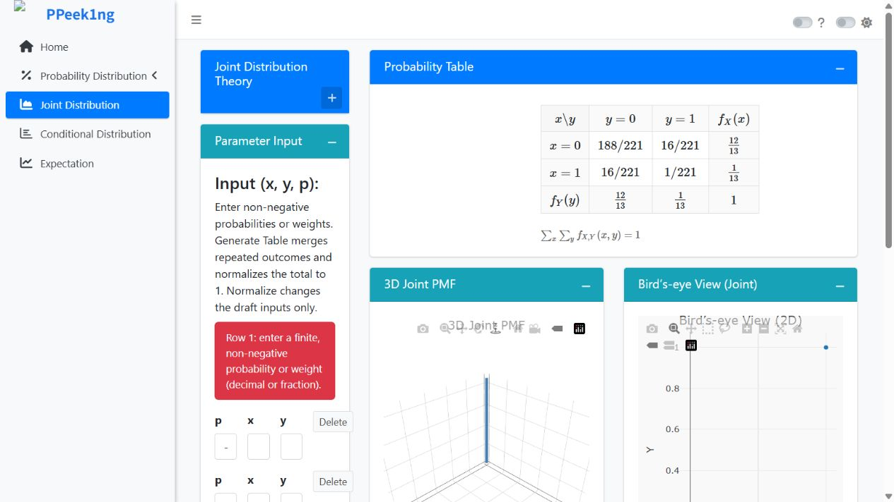
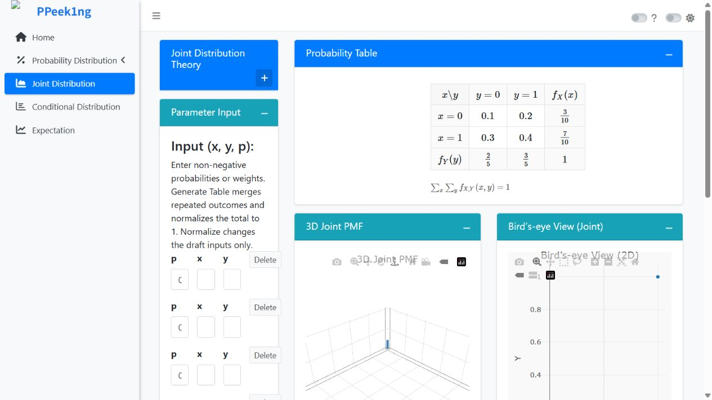

# R1-06 修复验证

日期：2026-10-30（Pacific/Auckland）。修复前基线：`491c137`。状态：**已修复、已验证，待教师复核**。独立本地提交说明：`Fix R1-06 PMF input validation and normalization`；尚未推送或部署。

## 修改与行为

- `modules/pmf_helpers.R` 统一解析、校验和三个按钮的行为，`main.R` 在三个模块前加载。Joint、Conditional、Expectation 不再各自复制归一化逻辑。
- 接受有限、非负的十进制、科学记数法和分数作为概率或相对权重；禁止空值、无法解析值、负数、零分母、非有限值、空表和零总质量。逐行验证发生在合并重复坐标之前，负值不能通过相加抵消。x/y 也必须有限。
- 错误提示显示在输入面板，指出问题行；失败时不覆盖已提交 PMF。图、边际、条件概率和期望继续使用上一张有效表。
- Generate 合并重复坐标并归一化，更新输入文本和数值。计算不再提前舍入至五位，微小负数不会被四舍五入成零。大权重先按最大权重缩放，避免总和溢出。
- Normalize 更新归一化草稿；Uniform 将现有输入行设为等权草稿，可以覆盖错误的 p 输入。这两个动作均不提交结果；Generate 才提交。空表仍保留 Add Row，编号单调递增，不复用已删除编号；提交后的新输入也使用新编号，避免旧绑定值回写。
- 同一会话中，三个模块响应已提交表的更新。全局状态的多会话隔离仍是 F1 待验证事项，本次没有把单会话同步当作多人隔离已通过。

## 修复前复现

在基线 `491c137` 的三个真实模块中分别输入 `-1,1,1,1` 并 Generate，均得到 `-.5,.5,.5,.5`，单元格仍显示原始 `-1,1,1,1`。详见 [修复前结果](r1_06_before.json)。这是三个负输入复现案例，不是对旧代码执行全部 124 个新案例的结果。

## 模块与集成验证

脚本：[test_r1_06.R](../scripts/test_r1_06.R)。使用实际 Shiny 模块的 `testServer`，不是只测试帮助函数。**124/124 通过**，详见 [结果 JSON 和源码 MD5](r1_06_regression.json)。

| 类别 | 实际检查 |
|---|---|
| 三个模块各 40 例 | Generate/Normalize 对 11 类无效输入的拒绝；空表三按钮、恢复控件、重新添加；6 组有效数据；Normalize/Uniform 草稿与提交；真实删除全部行、编号不复用及恢复提交 |
| 无效输入 | 负数、微小负数、abc、1/0、0/0、空字符串、Inf、NaN、数值溢出、残缺分数、全部零 |
| 有效数据 | 权重 1/2/3/4、分数、百万分之一量级、四个 1e308 权重、重复坐标、含零但总质量为正 |
| 下游一致性 | 输入文本与数值、完整联合表及边际；Joint 3D 图、Conditional 条件图、Expectation 的两个普通期望输出 |
| 同步 4 例 | Joint 提交更新三视图；Conditional 无效 Generate 保留三视图；Expectation 无效 Normalize 保留三视图；Expectation 有效提交更新三视图 |

非法输入时比较提交前后 PMF 与完整联合表，均保持不变且反馈非空。表格分数近似采用原有展示精度，校验允许 0.000011 的显示误差；内部质量和与图形按更严格的浮点容差比较。输入文本可往返为同一个浮点值。

**R1-05 重跑 11/11 通过**：[重跑结果](r1_05_after_r1_06.json)。原先 11 个场景和预期值不变，仅为测试脚本增加共享帮助函数加载，保留旧的五位小数夹具用于前后比较。原 R1-05 证据文件未覆盖。

从仓库根目录运行：

```powershell
& 'C:\Program Files\R\R-4.6.1\bin\x64\Rscript.exe' --vanilla review/scripts/test_r1_06.R
& 'C:\Program Files\R\R-4.6.1\bin\x64\Rscript.exe' --vanilla review/scripts/test_r1_05.R review/evidence/r1_05_after_r1_06.json
```

本次使用现有 R 4.6.1/Shiny 依赖。locale 启动警告未阻止测试。结果文件包含所测源码 MD5；课程材料与缓存仍留在本地忽略目录。

## 浏览器验证

在本地应用内浏览器中实际操作：

1. Joint 输入 `-1,1,1,1`，Generate 显示 Row 1 的错误提示；原四分数表及图保留。截图如下。
2. Joint 改为 `1,2,3,4`，Generate 后输入框和表均为 `.1,.2,.3,.4`；边际为 (.3,.7) 和 (.4,.6)。
3. 切到 Conditional，输入框同为四个归一化值；默认 `Y|X=0` 为 `.33333,.66667`，合计 `1.00000`。
4. 切到 Expectation，同一组概率给出 `E[X]=.7`、`E[Y]=.6`。将四项设为零后 Generate，出现总质量须大于零的提示，原期望仍为 `.7,.6`。
5. 结束测试时恢复有效的 `.1,.2,.3,.4` 示例。





其余边界、重复坐标和删除全表由模块回归覆盖，没有宣称全部在浏览器逐一点击。现有输入面板宽度和布局遮挡属于 R1-10，未在本次扩展修改。三个题库和练习判断逻辑保持修复前内容；剩余 9 项问题仍待处理。
